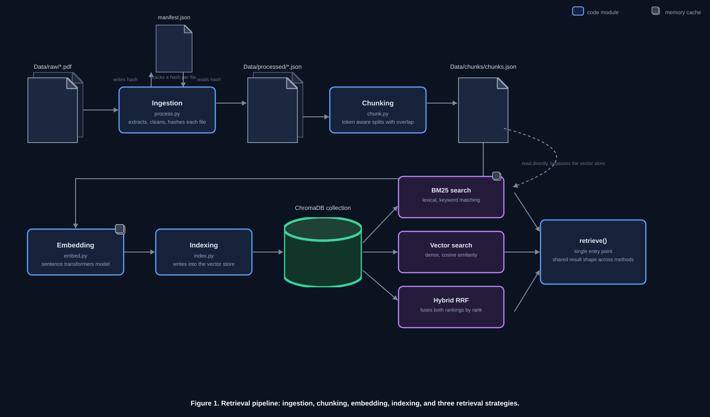
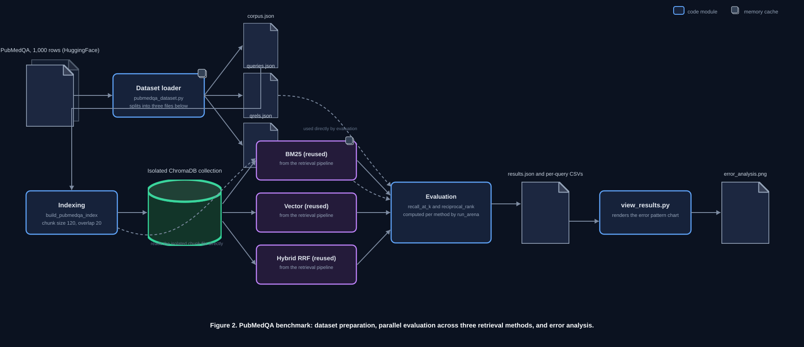
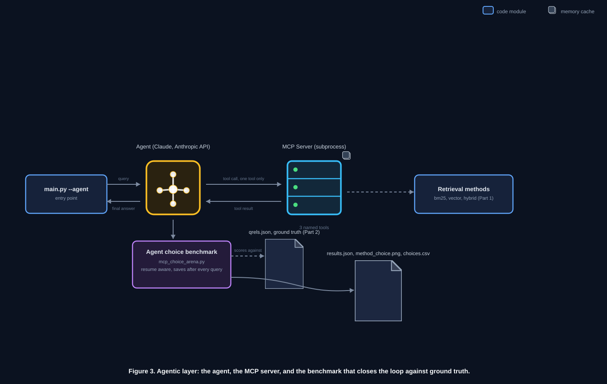

# AgenticRAG-Router

[](https://www.python.org/)
[](https://www.trychroma.com/)
[](https://pypi.org/project/rank-bm25/)
[](https://www.sbert.net/)
[](https://www.anthropic.com/)
[](https://modelcontextprotocol.io/)
[](https://docs.pytest.org/)
[](https://pymupdf.readthedocs.io/)
[](https://www.docker.com/)
[](https://github.com/Nabil-Haddad/AgenticRAG-Router/actions/workflows/ci.yml)

**A production-style RAG pipeline where an LLM agent chooses its own retrieval strategy through MCP, benchmarked against static baselines on 1,000 real biomedical questions.**

Built from scratch without LangChain or LlamaIndex, so every stage (chunking, embedding, indexing, retrieval, fusion) is visible in the code instead of hidden behind a framework call.

## At a glance

| | |
|---|---|
| Language | Python 3.12 |
| Benchmark | PubMedQA (`pqa_labeled`), 1,000 real biomedical question and abstract pairs |
| Retrieval methods | BM25, dense vector search, hybrid RRF fusion, each exposed as a named MCP tool |
| Agentic layer | An LLM agent selects the retrieval method per query via the Anthropic API and MCP |
| Headline finding | On this benchmark, hybrid search (which merges BM25 and vector results) does worse than plain vector search, and the cause is traced query by query. When an LLM agent is given the same three options with no hint about which is best, it picks hybrid most of the time and loses accuracy, which confirms the result a second way. |

## Why this exists

Most RAG projects treat hybrid retrieval as the safe default and stop there. This project tests that assumption. It builds the three retrieval strategies separately, evaluates them on a real benchmark, and finds a case where hybrid loses to the simpler vector search. It then asks whether an LLM agent, given all three as tools, would pick the best one on its own.

## Architecture



```
Data/raw/*.pdf
      | ingestion/process.py   extract, clean, strip headers and references, hash
      v
Data/processed/*.json    one file per source, page-level documents
      | ingestion/chunk.py      sentence-aware chunking, token budget and overlap
      v
Data/chunks/chunks.json   every chunk from every source
      | index/index.py          embed, store with a targeted update, not a full rebuild
      v
vectordb/                 persistent ChromaDB collection
      | retrieval/retrieve.py   bm25_search / cosign_simularity / search_hybrid_rrf
      v
retrieve(query, method) -> ranked results
      | mcp_server/server.py    same three methods exposed as named MCP tools
      v
mcp_server/client.py      agent selects a tool via the Anthropic API, executes it, answers
```

Every stage after extraction is idempotent per file. A manifest stores a content hash for each source file, so adding one document to the corpus reprocesses only that document, not the whole corpus.

## Results on PubMedQA, 1,000 questions



| Method | Recall@1 | Recall@5 | MRR |
|---|---|---|---|
| BM25 | 0.891 | 0.944 | 0.915 |
| Vector | 0.977 | 0.989 | 0.983 |
| Hybrid RRF | 0.946 | 0.991 | 0.965 |

Vector search alone is best on Recall@1 and MRR. Hybrid, the usual default, scores lower on both, and is ahead only on Recall@5 (99.1% vs 98.9%, a difference of two questions).

<details>
<summary><b>Why hybrid loses here</b></summary>

<br>

Reciprocal Rank Fusion (RRF) merges two ranked lists by giving each document a score of 1 / (k + rank) in each list and adding the scores. It has no way to tell which list is more reliable. That works when both retrievers are about equally good, but not here. Vector search already ranks the right document first 97.7% of the time, while BM25 often does not retrieve the right document at all.

Checking every query, hybrid fixed 8 questions that vector search got wrong, but broke 39 that vector search got right, a net loss of 31. In 69% of those 39 cases, BM25 never retrieved the correct document, so fusion gave it no extra support. A wrong document that both rankings placed fairly high, usually BM25's top pick, then collected more combined points and took first place.

Recall@5 is about the same for both (vector misses 11 of 1,000 questions, hybrid misses 9), but they fail in different ways. Vector has 12 near misses (the correct document at rank 2 to 5) and 11 misses outside the top 5. Hybrid has only 9 misses outside the top 5, but 45 near misses, where the right document is still retrieved but pushed down to rank 2 to 5. Recall@5 counts a near miss as a success, but MRR penalizes it, which is why hybrid's MRR is lower even though its Recall@5 is equal or slightly better.

Full per-query traces, error tables, and the supporting chart are in `results.md`.

</details>

## The agentic layer



The three retrieval methods are exposed as three separate MCP tools, `bm25_search`, `vector_search` and `hybrid_search`, instead of one tool with a method parameter. This makes the model's choice visible in the tool name itself, so it can be logged and compared against the benchmark results above.

`main.py --agent "question"` sends the query to the Anthropic API with all three tools attached and forces the model to call exactly one. Parallel tool calls are disabled, because a choice between tools only means something if a single call is made. The chosen tool runs through a real MCP session over stdio, and its result goes back to the model to write the final answer.

<details>
<summary><b>Engineering decisions behind the MCP server</b></summary>

<br>

- Tool descriptions only explain how each method works and give a neutral rule of thumb. They never say that vector search is the best, because that would make it meaningless to compare the model's choices against the benchmark.
- Standard output is redirected to standard error during every retrieval call. A stray print on an error path would otherwise corrupt the JSON-RPC stream that MCP relies on.
- The MCP library is pinned to version 1.29.0 instead of 2.0.0. The 2.0.0 release dropped the documented decorator-based server API for a much less documented one, which was confirmed by inspecting the installed package instead of trusting a changelog.
- Tested end to end with a real Anthropic API key, not only with mocks. The agent chose `vector_search` for a real query and gave a correctly grounded answer, which exercises the whole chain: starting the subprocess, the MCP handshake, the tool call, retrieval and the final answer.

</details>

**A second benchmark tests the agent itself, not just the retrieval methods.** `benchmarks/mcp_choice_arena.py` runs the same PubMedQA questions through the agent. For each question it records which tool the agent chose, scores that tool's results against the same ground truth, and compares them to a vector-only baseline on the same questions. Every question is a real, billed API call, so results are saved after each one. A run that stops partway keeps everything finished so far and can be resumed.

<details>
<summary><b>Result: does the agent rediscover the winning method on its own?</b></summary>

<br>

Run on the full 1,000-question set, with tool descriptions that never hint which method performs best:

| | Recall@5 | MRR |
|---|---|---|
| Claude's chosen method | 0.983 | 0.963 |
| Vector-only baseline | 0.989 | 0.982 |

Claude picked hybrid RRF 67% of the time (673/1,000), vector 26% (258/1,000) and BM25 6% (63/1,000). It leans toward the common belief that hybrid is the safe choice, instead of the method this project's own benchmark shows is better here. Of the 37 questions where Claude's pick scored worse than vector alone, 24 came from picking hybrid, which repeats the headline finding: in 22 of them the correct document was still retrieved but dropped from rank 1, which Recall@5 ignores and MRR penalizes (the other 2 were complete misses). A smaller, separate problem also appeared: 6 of the 1,000 calls named a tool that was never offered. These were scored as misses and did not crash the run.

Full breakdown, per-query traces, and the chosen-method chart are in `results.md`.

</details>

## Engineering highlights

- **Idempotent pipeline.** A content hash per file means adding one document reprocesses only that document. This was checked by counting vectors before and after a real change, not assumed from the code.
- **Token-aware chunking.** Chunk size is counted with the embedding model's own tokenizer, so every chunk fits the model's 256-token input limit and nothing is cut off before embedding. Ingestion fails if any chunk would be too long.
- **A silent bug found by checking how the pipeline's parts fit together, then fixed and re-benchmarked ([#4](https://github.com/Nabil-Haddad/AgenticRAG-Router/issues/4), [#5](https://github.com/Nabil-Haddad/AgenticRAG-Router/issues/5)).** Chunks were sized with one tokenizer (tiktoken, 400 tokens), but the embedding model uses a different tokenizer and stops reading after 256 tokens. As a result, 96% of chunks had about a third of their text ignored when embedded, with no error or warning. The fix counts chunk size with the embedding model's own tokenizer and fails ingestion if a chunk is too long. The same check found that the vector database compared vectors with L2 distance while the retrieval function was named and described as cosine similarity, and that nothing recorded which model had built the index. Collections now use cosine similarity and refuse to open if they were built by a different embedding model, and the ingestion manifest reprocesses everything when the model or chunk settings change. Both benchmarks were re-run afterwards and the results moved by 0.5 points or less. The PubMedQA benchmark was not affected by the truncation bug because it uses 120-token chunks, so the fix matters for the default 250-token setup.
- **A fair benchmark method.** An early version of the timing benchmark ran all trials of one method before the other, so background system noise could favor whichever ran in a quieter period, and it reported no variance. It was rebuilt to alternate trials and report the mean and standard deviation at three corpus sizes.
- **Bugs found by running the pipeline on its own output, not only by testing.** Examples: a query embedding mismatch that worked only by accident, a reference-stripping rule that let whole bibliography pages through, and a later stage that kept re-embedding the entire corpus even though the manifest had correctly flagged only one changed file.

<details>
<summary><b>Full list of bugs found and fixed</b></summary>

<br>

**Pipeline**
- Chunk size was counted with tiktoken (400 tokens), but the embedding model, all-MiniLM-L6-v2, silently stops reading at 256 WordPiece tokens ([#4](https://github.com/Nabil-Haddad/AgenticRAG-Router/issues/4)). On the real corpus, 107 of 111 chunks (96.4%) were too long, and about 32% of each chunk's text never reached the embedding. Fixed by counting with the model's own tokenizer (default chunk size 250, overlap 40), splitting oversized sentences by character position so the original text stays intact, and stopping ingestion if any chunk is over the limit. The new check immediately exposed a second bug: overlap sentences carried over from the previous chunk could push a new chunk over its size limit. Fixed, with a regression test that fails without the fix.
- ChromaDB collections used its default L2 distance, while `cosign_simularity` was named, and assumed to be, cosine similarity ([#5](https://github.com/Nabil-Haddad/AgenticRAG-Router/issues/5)). The returned "score" was therefore a distance, where lower is better. Collections are now created with cosine distance and the function returns `1 - distance`. Each collection also stores the embedding model name, and opening one built with a different model or distance setting raises an error instead of silently mixing vectors.
- The ingestion manifest only tracked file hashes, so changing the embedding model or chunk settings would not reprocess unchanged files. It now also stores the embedding model and chunk settings, and any change reprocesses everything.
- `cosign_simularity` originally let ChromaDB use its own default embedder instead of the project's configured one. The two happened to match, so it worked by accident, and would have given wrong results as soon as the embedding model changed.
- The reference-stripping rule only looked for citation markers at the start of a line, so it missed bibliography pages where one citation wraps over several lines. A real query for "machine learning algorithms" returned mostly raw citation text. Before the fix, 27 of 147 chunks were pure bibliography. After it, 0.
- The sentence splitter treated `"et al. "` as the end of a sentence, so some chunks started in the middle of a sentence with no context.
- The manifest correctly detected which files changed, but the chunking and indexing stages ignored that and reprocessed the entire corpus anyway. Found by checking the actual chunk and vector counts after changing one file, not by a failing test.

**MCP and agent**
- A `top_k` parameter was accepted by the agent's request function but never used, so callers passing different values got identical behavior. Fixed by adding it to the prompt, and verified by checking the sent text at two different values.
- A real API failure showed up as an unreadable nested exception group, because the MCP stdio client wraps errors in a way a plain `except` does not catch. Fixed with a recursive function that finds the real exception at any depth of nesting.

**Testing**
- A test that mocked three sequential calls with one shared `return_value` dict broke the second and third calls, because production code removes a key from each result and they all saw the already-modified dict. Fixed with `side_effect`, so each call gets a fresh object, as it would in production.
- `MagicMock(name=...)` does not set a `.name` attribute, because `name` is reserved by the mock library's constructor. It has to be assigned after the mock is created.
- The cache of an `lru_cache`'d helper lasted for the whole test session, so a stale value from one test leaked into the next. Fixed with an autouse fixture that clears it before and after every test.

</details>

## Known limitations

- The production ingestion pipeline has only been exercised against 3 sample PDFs.
- Idempotency tracks the extracted text plus the embedding model and the chunk size and overlap settings, but not the chunking code. If the chunking algorithm is edited without changing those settings, files whose text did not change will not be reprocessed.
- `--agent` mode makes live, billed Anthropic API calls. Everything else in this project is local and free to run.

## Running it

```bash
pip install -r requirements.txt

python build_index.py                          # build or refresh the index from Data/raw/*.pdf
python main.py "your question"                  # direct retrieval, default method
python main.py --method bm25 "your question"     # force a specific method
python main.py --agent "your question"            # let the agent choose (needs ANTHROPIC_API_KEY)

python -m benchmarks.pubmedqa_arena             # re-run the PubMedQA benchmark
python view_results.py                            # view the per-query error analysis chart
python -m benchmarks.mcp_choice_arena --sample-size 30  # test the agent's own tool choice (needs ANTHROPIC_API_KEY)
pytest                                              # run the 179 tests
```

### Running it with Docker

The project is also containerized, so it can run without installing Python or any dependency locally.

```bash
docker build -t retrieval-arena:latest .

docker run --rm \
  -v $(pwd)/vectordb:/app/vectordb \
  -v $(pwd)/Data:/app/Data \
  retrieval-arena:latest "your question"
```

`Data/` and `vectordb/` are mounted at run time instead of being built into the image, because they are runtime state (the corpus and its index), not code. This keeps the image generic and means rebuilding the corpus never requires rebuilding the image.

`requirements.txt` installs the CPU-only build of `torch`, not the CUDA one. Every direct dependency is pinned to the exact tested version, so the image gets the same environment as local development without several extra gigabytes of GPU libraries this project never uses.

### CI

Every push and pull request to `main` runs the full test suite with GitHub Actions (`.github/workflows/ci.yml`): checkout, Python 3.12, install `requirements.txt`, `pytest`. No `ANTHROPIC_API_KEY` or live API calls are involved, because the tests mock the Anthropic API and the MCP subprocess. The CI badge at the top shows the status of the latest run on `main`.

## Project layout

```
src/retrieval_arena/
|-- config.py               central settings, sourced from .env
|-- ingestion/               extraction, cleaning, chunking, embedding
|-- index/                   ChromaDB indexing
|-- retrieval/                bm25_search, cosign_simularity, search_hybrid_rrf, retrieve()
`-- mcp_server/               server.py exposes the 3 methods as MCP tools, client.py bridges to the Anthropic API

benchmarks/                   evaluation harnesses, kept separate from library code
tests/                         mirrors src/retrieval_arena/ and benchmarks/, 179 tests
build_index.py                 root orchestrator, run the full ingestion pipeline
main.py                        root orchestrator, query directly or via --agent
view_results.py                per-query error analysis chart
Dockerfile, .dockerignore       container build, CPU-only, pinned to the exact dependency versions above
.github/workflows/ci.yml       runs the test suite on every push and pull request to main
```

## Stack
Python, ChromaDB, rank_bm25, sentence-transformers, Anthropic API, MCP, pytest, PyMuPDF, Docker
## License

MIT, see [LICENSE](LICENSE).